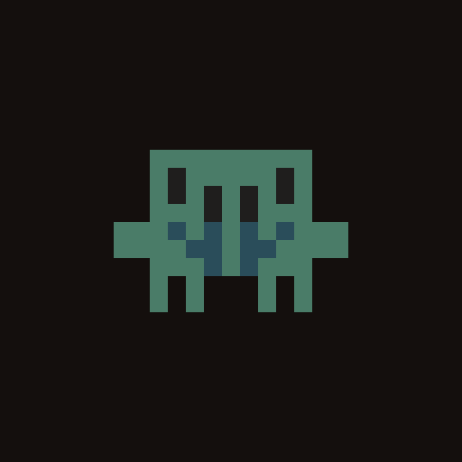
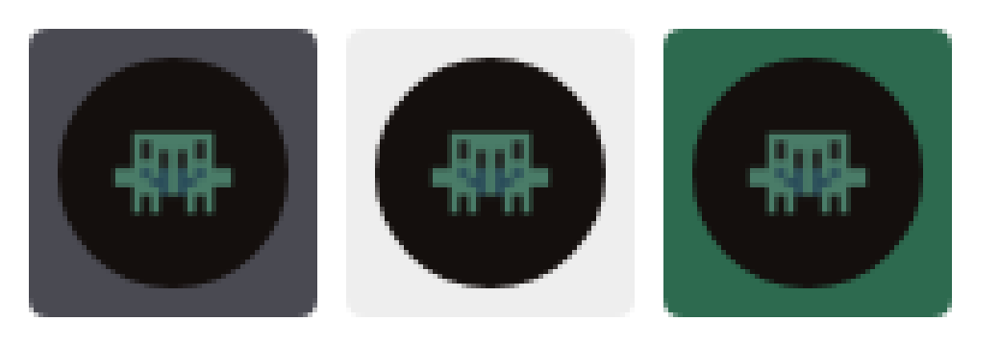

Responde a: 9473ba5 (H3-encargo, icono para la pantalla de inicio, D52)

# H3 — Informe (fase 9, icono para la pantalla de inicio, D52)

> **Lo importante primero:** las piezas están hechas y las pruebas pasan, pero **con la CSP actual el navegador no
> carga ni el favicon ni los iconos del manifest**, así que el icono no llegaría a la pantalla de inicio. El encargo
> (§1.3) suponía que la CSP no afectaba a los iconos; lo he comprobado y no es cierto. Arreglarlo toca `img-src`, que
> fija la normativa W10, así que **paro y lo dejo en «Decisiones que necesito»**.

## Hecho

Rama `fase9` (worktree `/data/klothulhu-fase9`), tres commits, citando D52:

| Pieza | Commit | Qué |
|---|---|---|
| script e iconos | 80ec69a | `desktop/scripts/make-icons.js` y `web/icons/icon-192.png`, `icon-512.png`, `apple-touch-icon.png` (180×180) |
| manifest y `index.html` | bf2d546 | `web/manifest.json`; las tres `<link>` con rutas relativas; `manifest-src 'self'` añadido a la CSP, sin tocar nada más; `dev-server.js` sirve `.png` |
| pruebas | cd553d9 | `web/test/icons.test.js` (fichero nuevo) |

**Pruebas:** `cd web && npm test` → 31/31 (25 de antes + 6 nuevas); `npm run check` limpio. `cd desktop && npm test` → 69/69;
`npm run check` limpio. No he tocado `desktop/renderer/`, `main.js`, `preload.js`, `state.js`, `server/` ni ninguna normativa.

`icons.test.js` cubre lo pedido: `manifest.json` válido con los campos del §1.2 y cada icono declarado existe; firma PNG y
dimensiones de `IHDR` (192, 512, 180); las tres `<link>` relativas (y que apuntan a ficheros que existen); `manifest-src 'self'`
con `img-src` todavía `data:`. Y dos de más (desviación 5).

**El icono** (`icon-512.png`; la captura a 48 px y en círculo es `docs/fase9/capturas/10-icono-48px.png`):

Klothulhu verde, `pixel`, sobre `#140f0d`, centrado. En la captura (48 px reales, ampliados 5× sin suavizado solo para verlos) se
reconocen la cabeza, los ojos y las patas, pero el personaje queda pequeño: ocupa unos 24 px de 48. Es lo máximo con escala
entera dentro del 60 % seguro (con escala 6, a 512 px, ocuparía el 61 %).

**Cómo se dibuja** (el §1.1 preveía que el motor no sabría): el motor no pinta al personaje sin escenario y exige un `caption`,
con lo que siempre sale un fondo y un bocadillo. Usé la escena más limpia que tiene: `space`, sin partículas ni props, acción
`inspect` (probé 4 backdrops y 10 acciones; `walk`, `inspect`, `peek` y `point` salen sin ningún extra). El script limpia el SVG que
devuelve el motor: quita el bocadillo (`<g data-part="speech">`), cambia el color de fondo del motor por `#140f0d` y recorta un
cuadrado centrado en el personaje. No hay nada dibujado a mano, y a 48 px queda limpio, así que no hizo falta parar por el §1.1.

**Pasada a mano** (`dev-server.js` en :5858 + Chrome headless por CDP; ya parado):
- `manifest.json` se sirve como `application/json`, los tres PNG como `image/png`.
- Las `<link>` están en el DOM con sus rutas relativas, y el manifest se descarga (200).
- **El navegador bloquea los iconos por la CSP** (ver abajo).

## Gasto

0. Sin API ni servidor de pruebas; el servicio de producción no se tocó.

## Desviaciones

1. **El icono sale de la escena `space` + `inspect`, con el SVG limpiado** (bocadillo quitado, fondo cambiado, recorte), no de «el avatar sobre un fondo liso». Detalle arriba.
2. **Escala entera por tamaño**, para que los píxeles del pixel art salgan iguales y nítidos: 192 → ×2 (personaje al 54 %), 512 → ×5 (51 %), 180 → ×2 (58 %). El 60 % seguro se cumple en los tres.
3. **El SVG va en línea y con las animaciones paradas en t=0.** `inspect` oscila ±8 unidades, y mi primera versión, que capturaba un fotograma cualquiera, salió descentrada
   (borde izquierdo en 93 px en vez de 126). Lo vi mirando el PNG; ahora es determinista (dos ejecuciones dan los mismos bytes) y lo vigila una prueba (ver 5).
4. **`web/dev-server.js` sirve `.png` con su tipo** (una línea): sin ella entregaba los iconos como binario. nginx ya lo hace bien; es solo mi servidor de pruebas.
5. **Pruebas de más:** que el personaje está centrado y dentro del 60 % en cada PNG (con un decodificador mínimo de PNG en la propia prueba, sin dependencias; habría cazado la
   desviación 3), y que `background_color` y `theme_color` del manifest son los de la web.
6. **`make-icons.js` quita `TMPDIR` al lanzar Chrome:** con una ruta larga, Chrome falla con «Socket path too long».
7. **`npm run check` de `desktop/` no revisa el script nuevo** (lista ficheros concretos y no lo incluyo: no he tocado `desktop/package.json`). Lo comprobé aparte con `node --check desktop/scripts/make-icons.js`.

## Decisiones que necesito

**1. La CSP bloquea los iconos (hay que decidir cómo arreglarlo).** El encargo decía que los iconos no pasan por la CSP de la página. En Chrome sí pasan.
Lo medí con Chrome headless y `Page.getAppManifest`, sobre la página tal como está:

| | CSP actual (`img-src data:`) | Copia fuera del repo, con `img-src 'self' data:` |
|---|---|---|
| `<link rel="icon">` | bloqueado por CSP | carga |
| icono del manifest | bloqueado por CSP; aviso «Error while trying to use the following icon from the Manifest» | carga |
| `apple-touch-icon` | violación de `img-src` en la consola | sin violación |
| consola | 4 errores de CSP y 1 aviso | vacía |

Samsung Internet (Chromium) usa esos mismos iconos para el acceso directo, así que lo más probable es que Josem vuelva a ver un icono genérico. **No lo he podido
probar en Samsung**: solo en Chrome.

`img-src` lo fija W10 (`deepEqual(dir['img-src'], ['data:'])`) y el encargo me manda no tocarlo, así que no lo he cambiado. Opciones:

- **A (la que recomiendo):** `img-src 'self' data:`. Es un cambio de una palabra, y deja las imágenes solo del propio origen (no abre nada externo). Hay que cambiar W10, que es normativa, y la
  edita el arquitecto; mi aviso de `icons.test.js` («`img-src` sigue siendo `data:`») lo cambio yo. Lo he comprobado en Chrome.
- **B:** dejar la CSP y meter los iconos como `data:` URI en las `<link>` y en el manifest. Cumple la CSP, pero duplica los PNG en el HTML y el JSON, hay que regenerarlos con el
  script cada vez, y no sé si el acceso directo de Samsung acepta un `data:` en `apple-touch-icon`; tampoco lo puedo comprobar aquí.

Paro aquí. El merge y volver a añadir el acceso directo en el móvil (el viejo hay que borrarlo) son de Josem, pero **no tiene sentido hacerlos hasta que se resuelva esto**.
